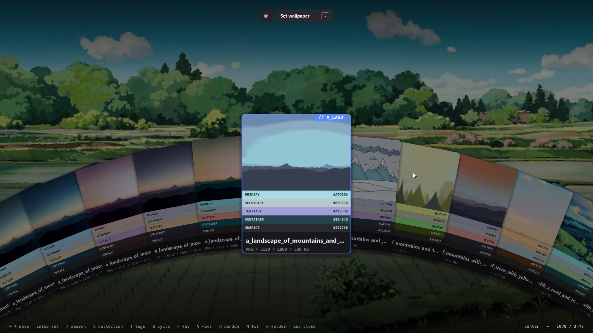

<div align="center">


# WallpaperSuite

Lightweight, fully offline wallpaper manager for Windows. A background tray daemon applies wallpapers on schedule or hotkey; a WPF arc-carousel picker opens only when you need it.

<p>
<a href="LICENSE"></a>
<a href="https://dotnet.microsoft.com/"></a>


</p>

<p>
<a href="https://github.com/zero1-spec/wallpaper-picker/releases/latest"></a>
</p>

<p>
<a href="#features">Features</a> &bull;
<a href="#install">Install</a> &bull;
<a href="#quick-start">Usage</a> &bull;
<a href="#build-from-source">Build</a> &bull;
<a href="#roadmap">Roadmap</a>
</p>

</div>

---

## Screenshots



Picker: arc-carousel wallpaper browser with palette, favorites, and search.


Tray: system tray menu with auto-change, collections, and live wallpaper controls.

---

## At a glance

| | |
|-|-|
| <kbd>Alt</kbd> + <kbd>Shift</kbd> + <kbd>W</kbd> | Open picker |
| <kbd>Alt</kbd> + <kbd>Shift</kbd> + <kbd>Right</kbd> | Next wallpaper |
| <kbd>Alt</kbd> + <kbd>Shift</kbd> + <kbd>Left</kbd> | Previous wallpaper |

## Why WallpaperSuite?

- **Light.** The daemon idles at ~13 MB private memory and 0% CPU — no polling, timers run only when needed.
- **Offline.** No network ports, no local server, no accounts. Everything runs on your PC.
- **No admin.** Installs per-user to `%LOCALAPPDATA%\Programs\WallpaperSuite`. Uninstall keeps your data.
- **Hotkey-first.** Global hotkeys for open, next, previous, pause — editable in Settings.
- **Picker on demand.** The WPF picker closes after you apply or press Esc; it does not stay resident.

## Features

| Area | What it does |
|------|-------------|
| 🎨 **Picker** | Arc carousel with cover-crop thumbnails, live background crossfade, 5-color palette per wallpaper, search matches filename and tags |
| ⭐ **Favorites** | Heart button (`F`), favorites-only filter (`V`), favorites cycle with `B` |
| 🔄 **Auto-change** | Random or sequential mode, interval 1–1440 minutes (default 30), history of last 50, never repeats twice in a row |
| 🌓 **Day/Night** | Different wallpaper folders by time of day (default night 19:00–07:00) |
| ⏸️ **Smart pause** | Skips ticks during fullscreen apps/games or battery saver, logged in `walld.log` |
| 🎨 **Accent color** | Syncs Windows accent color from the wallpaper's primary palette color (optional, off by default) |
| 📁 **Drag and drop** | Drop images or folders onto the picker to add them (paths stored, no file copying) |
| 🔍 **Duplicate finder** | Tray menu finds duplicates by size + SHA-256, sends to Recycle Bin with confirmation, removes missing entries |
| ⌨️ **Hotkeys** | Global hotkeys for open / next / previous / pause, editable in Settings |
| 💻 **CLI** | `walld.exe open\|next\|prev\|random\|pause\|resume\|toggle-pause\|set <path>\|quit` |

## Install

1. Download `WallpaperSetup-0.4.0.exe` from Releases.
2. Run it. The installer is per-user (`%LOCALAPPDATA%\Programs\WallpaperSuite`) — **no administrator rights needed**. "Start with Windows" is checked by default.
3. The publish is self-contained (`.NET 8 runtime bundled`), so you do **not** need to install .NET separately.
4. Uninstall from Windows Settings → Apps → WallpaperSuite. Your user data in `%APPDATA%\WallpaperPicker` is kept.

> [!WARNING]
> The installer is unsigned, so Windows SmartScreen may block it. Choose **More info → Run anyway**.

> [!NOTE]
> Platform: **Windows 11 (tested)**. Windows 10 (version 1607+) should work but is not tested yet.

## Quick start

After install, `walld.exe` starts minimized to the tray with "Start with Windows". Right-click the tray icon to open the picker, change wallpaper, or open Settings.

### Keyboard shortcuts

Open the picker with the tray menu or <kbd>Alt</kbd> + <kbd>Shift</kbd> + <kbd>W</kbd>.

| Key | Action |
|-----|--------|
| <kbd>Left</kbd> / <kbd>H</kbd> | Move 1 card back |
| <kbd>Right</kbd> / <kbd>L</kbd> | Move 1 card forward |
| <kbd>Up</kbd> / <kbd>K</kbd> | Move 10 cards back |
| <kbd>Down</kbd> / <kbd>J</kbd> | Move 10 cards forward |
| <kbd>PageUp</kbd> | Move 25 cards back |
| <kbd>PageDown</kbd> | Move 25 cards forward |
| <kbd>Home</kbd> | Jump to first |
| <kbd>End</kbd> | Jump to last |
| <kbd>Enter</kbd> | Apply centered wallpaper |
| <kbd>Esc</kbd> | Close without applying |
| <kbd>/</kbd> | Open search box |
| <kbd>F</kbd> | Toggle favorite |
| <kbd>V</kbd> | Toggle favorites-only filter |
| <kbd>R</kbd> | Jump to random wallpaper |
| <kbd>M</kbd> | Cycle fit mode (fill/fit/stretch/center/tile) |
| <kbd>O</kbd> | Choose folder |
| <kbd>E</kbd> | Export palette (CSS/JSON/TOML) |
| <kbd>C</kbd> | Add/remove to collection |
| <kbd>T</kbd> | Edit tags (comma-separated) |
| <kbd>B</kbd> | Cycle All / Favorites / collections |
| Wheel | Scroll the arc one card per notch |

<details>
<summary>Full picker shortcut table</summary>

| Key | Action |
|-----|--------|
| <kbd>Left</kbd> / <kbd>H</kbd> | Move 1 card back |
| <kbd>Right</kbd> / <kbd>L</kbd> | Move 1 card forward |
| <kbd>Up</kbd> / <kbd>K</kbd> | Move 10 cards back |
| <kbd>Down</kbd> / <kbd>J</kbd> | Move 10 cards forward |
| <kbd>PageUp</kbd> | Move 25 cards back |
| <kbd>PageDown</kbd> | Move 25 cards forward |
| <kbd>Home</kbd> | Jump to first |
| <kbd>End</kbd> | Jump to last |
| <kbd>Enter</kbd> | Apply centered wallpaper |
| <kbd>Esc</kbd> | Close without applying |
| <kbd>/</kbd> | Open search box |
| <kbd>F</kbd> | Toggle favorite |
| <kbd>V</kbd> | Toggle favorites-only filter |
| <kbd>R</kbd> | Jump to random wallpaper |
| <kbd>M</kbd> | Cycle fit mode |
| <kbd>O</kbd> | Choose folder |
| <kbd>E</kbd> | Export palette (CSS/JSON/TOML) |
| <kbd>C</kbd> | Add/remove to collection |
| <kbd>T</kbd> | Edit tags (comma-separated) |
| <kbd>B</kbd> | Cycle All / Favorites / collections |
| Wheel | Scroll the arc one card per notch |

</details>

### Tray menu

Right-click the tray icon: **Open picker**, **Next wallpaper**, **Previous wallpaper**, **Collection** submenu, **Find duplicates…**, **Auto change** (checkbox), **Settings…**, **Start with Windows** (checkbox), **Open data folder**, **Exit**.

<details>
<summary>CLI commands walld.exe</summary>

| Command | Effect |
|---------|--------|
| `open` | Open the picker |
| `next` | Apply next wallpaper |
| `prev` | Apply previous wallpaper |
| `random` | Apply random wallpaper |
| `pause` | Stop auto-change |
| `resume` | Start auto-change |
| `toggle-pause` | Toggle auto-change |
| `set <path>` | Apply an explicit image file |
| `quit` | Stop the daemon |
| `--background` | Start the daemon silently without opening the picker (used by autostart) |

</details>

## Configuration

User data lives in `%APPDATA%\WallpaperPicker`:

| File / folder | Purpose |
|---------------|---------|
| `config.json` | All settings (folders, hotkeys, fit mode, accent sync, etc.) |
| `history.json` | Last 50 applied wallpapers |
| `collections.json` | User-defined collections (name → paths) |
| `meta.json` | Thumbnails and per-wallpaper tags |
| `thumbs/` | Thumbnail cache |
| `export/` | Palette exports (`palette.css`, `palette.json`, `palette.toml`) |
| `converted/` | Non-native images (e.g. .webp) converted to PNG |
| `logs/walld.log` | Daemon log |

Important `config.json` options:

| Option | Meaning |
|--------|---------|
| `RootFolder` | Main wallpaper folder |
| `ExtraFolders` | Additional folders added by drag-and-drop |
| `DayFolder` / `NightFolder` | Day/night auto-change folders (optional) |
| `NightStart` / `NightEnd` | Night window hours:minutes (default 19:00–07:00) |
| `ActiveCollection` | Collection name for auto-change filtering (empty = all) |
| `SyncAccentColor` | Sync Windows accent from wallpaper primary color (default off) |
| `PauseOnFullscreen` / `PauseOnBatterySaver` | Smart pause (default on) |
| `AutoChangeIntervalMinutes` | Auto-change interval, 1–1440 (default 30) |
| `FitMode` | fill / fit / stretch / center / tile |

Options with **no Settings UI yet**: DayFolder/NightFolder times, ExtraFolders, ActiveCollection — edit `config.json` directly while the daemon is not running.

## Performance

Measured on Windows 11, idle, ~5 seconds after `walld.exe --background` start (installed 0.4.0 build, no `config.json` present):

| Metric | Value |
|--------|-------|
| Private memory | ~13 MB (Task Manager shows ~12.7 MB) |
| Total working set | ~47 MB (includes shared .NET runtime pages) |
| Idle CPU | 0% |
| Power usage | Very low |

`wallpicker.exe`: not measured yet.

Why it stays light:
- No polling — the auto-change timer sleeps until the next boundary
- Picker closes after apply; daemon uses zero timers when auto-change is off
- GC settings from `Walld.csproj`: `ConcurrentGarbageCollection=false`, `ServerGarbageCollection=false`, `TieredPGO=false`

## Build from source

Prerequisites:
- .NET 8 SDK
- Optionally Inno Setup 6 (to build the installer)

```powershell
git clone https://github.com/zero1-spec/wallpaper-picker
cd wallpaper-picker
dotnet build WallpaperSuite.sln
dotnet run --project src/Walld
```

To build the installer:

```powershell
.\build\build-installer.ps1
```

Output: `installer\Output\WallpaperSetup-0.4.0.exe`.

<details>
<summary>Architecture / Project structure</summary>

```
WallpaperSuite/
├── src/
│   ├── WallpaperSuite.Core/   # Shared library: config, JSON store, hotkey spec, wallpaper applier, logger, IPC
│   ├── Walld/                 # walld.exe — WinForms tray daemon (no window), auto-change, duplicates, settings
│   └── WallPicker/            # wallpicker.exe — WPF arc-carousel picker UI
│   └── WallVideo/             # wallvideo.exe — proof-of-concept live wallpaper player
├── build/                     # PowerShell build scripts (publish.ps1, build-installer.ps1)
├── installer/                 # Inno Setup 6 script → installer/Output/
├── docs/screenshots/          # Screenshots (picker.png, tray.png)
├── assets/                    # Icon source (icon.png) and generated icon.ico
├── WallpaperSuite.sln         # Classic .NET solution (4 projects)
├── CONTRIBUTING.md
├── LICENSE                    # MIT
└── README.md
```

`walld.exe` is a tiny tray daemon (WinForms, no main window) that runs auto-change, handles global hotkeys, and serves IPC via `WM_COPYDATA` (no network ports, no local server). `wallpicker.exe` is the WPF UI that opens only when needed and closes after you apply or press Esc. Single instance is enforced by a named mutex (`Local\WallpaperSuite.Walld`).

</details>

<details>
<summary>Troubleshooting / FAQ</summary>

| Problem | Fix |
|---------|-----|
| Hotkey "already in use" | A balloon warning appears; change the hotkey in Settings. |
| <kbd>Alt</kbd> + <kbd>Shift</kbd> switches keyboard layout | Some PCs map this to input-language switching; change the hotkey in Settings. |
| SmartScreen blocks installer | Unsigned installer. Choose **More info → Run anyway**. |
| `.webp` images skipped | WPF needs a WIC WebP codec. Install one, or use `.jpg`/`.png`/`.bmp`. |
| Wallpaper not changing | Check `%APPDATA%\WallpaperPicker\logs\walld.log`. |
| Reset configuration | Stop the daemon (`walld.exe quit`), then delete `config.json`. |
| Platform | Windows 11 (tested). Windows 10 (version 1607+) should work but is not tested yet. |

</details>

## Roadmap

- [x] Arc carousel picker with palette, favorites, fit modes, search
- [x] Collections and tags
- [x] Auto-change with history (next/prev)
- [x] Day/night folders
- [x] Smart pause (fullscreen app, battery saver)
- [x] Palette export (CSS/JSON/terminal TOML)
- [x] Windows accent color sync
- [x] Drag and drop
- [x] Duplicate finder with recycle bin
- [x] Global hotkeys with hotkey recorder
- [x] Autostart
- [x] CLI commands
- [x] Fully offline, no admin rights
- [ ] Video / live wallpaper
- [ ] Day/Night folder UI in Settings (edit config.json for now)
- [ ] Multi-monitor support
- [ ] Code signing for the installer

## Contributing

Fork, create a branch, make your change, and ensure `dotnet build WallpaperSuite.sln` has **0 errors / 0 warnings**. Keep the daemon RAM low and idle CPU at 0% — no polling. See [`CONTRIBUTING.md`](CONTRIBUTING.md).

## License

MIT. See [`LICENSE`](LICENSE).

<p align="center">Made with .NET</p>
