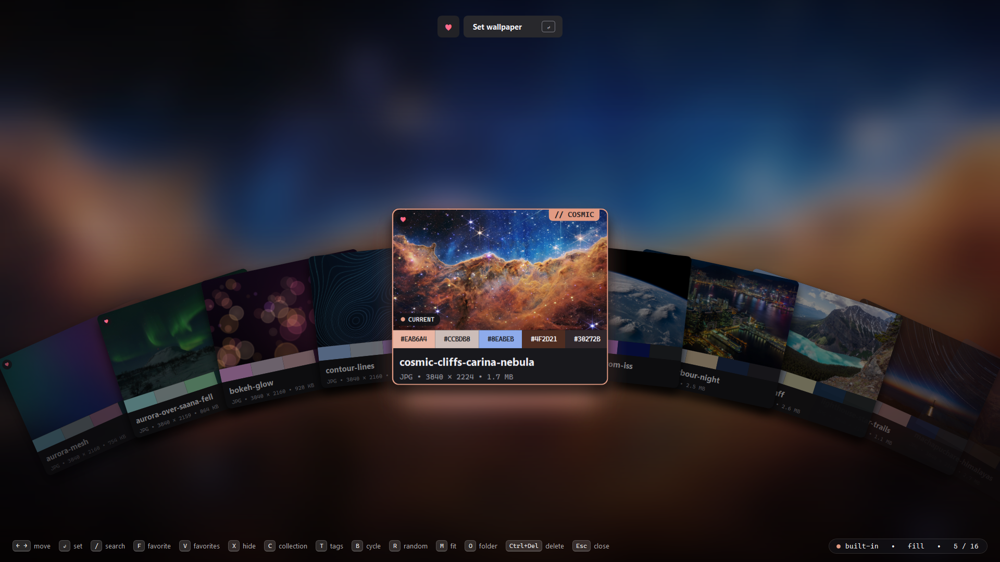
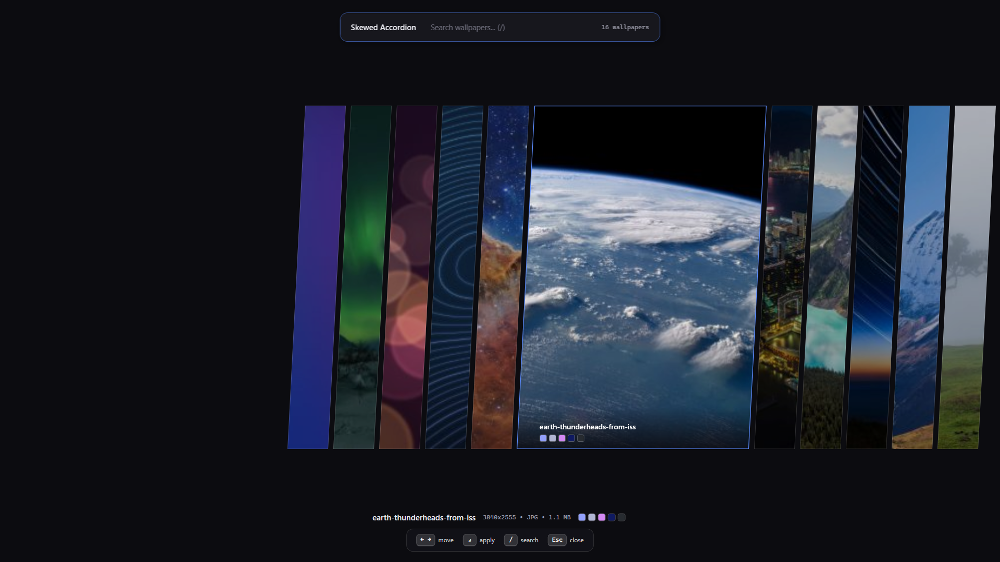
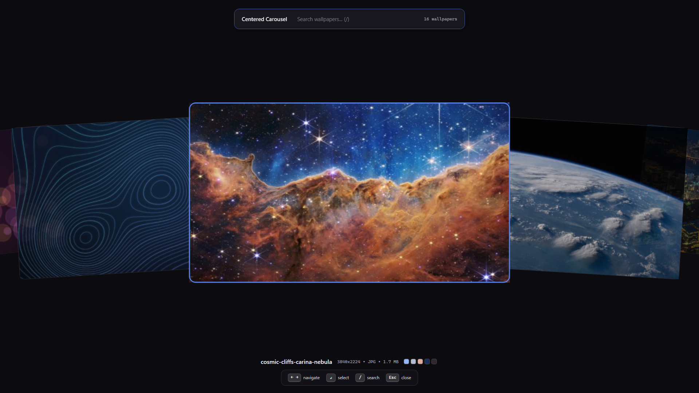
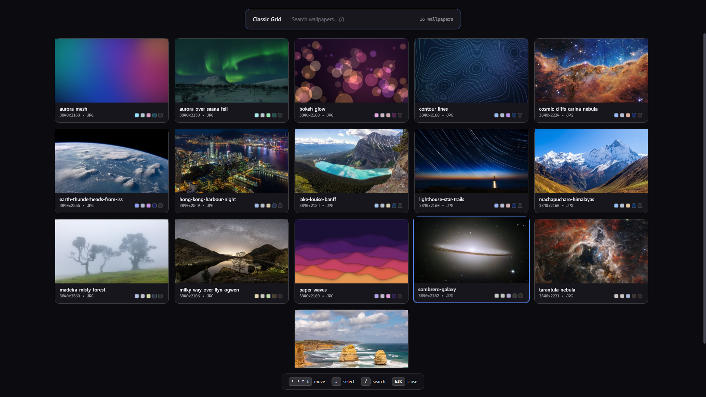
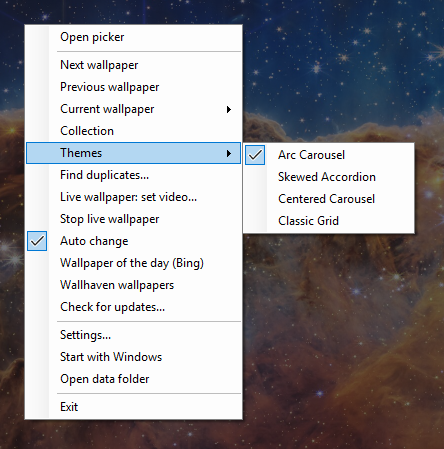
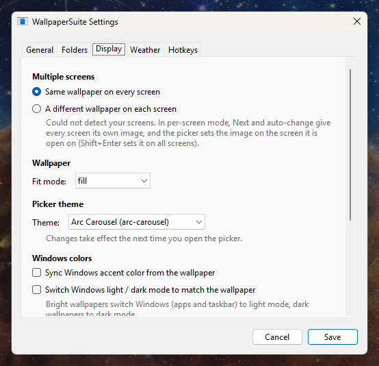

<div align="center">


# WallpaperSuite

Lightweight, offline-first wallpaper manager for Windows. A background tray daemon applies wallpapers on schedule or hotkey; a WPF picker with modular themes opens only when you need it. Ships with 16 built-in wallpapers, so it works the moment it is installed.

<p>
<a href="LICENSE"></a>
<a href="https://dotnet.microsoft.com/"></a>


</p>

<p>
<a href="https://github.com/zero1-spec/wallpaper-picker/releases/latest"></a>
</p>

<p>
<a href="#features">Features</a> &bull;
<a href="#install">Install</a> &bull;
<a href="#quick-start">Usage</a> &bull;
<a href="#build-from-source">Build</a> &bull;
<a href="#roadmap">Roadmap</a>
</p>

</div>

---

## Showcase

<div align="center">


*Modular picker themes cycling through the 16 built-in wallpapers.*

</div>

### Picker themes

| Arc Carousel *(default)* | Skewed Accordion |
|:---:|:---:|
|  |  |
| Blurred backdrop, 5-color palette swatches, favorites, collections & tags | Slanted parallelogram slices with smooth accordion expansion & search pill |

| Centered Carousel | Classic Grid |
|:---:|:---:|
|  |  |
| Prominent 16:9 center card with tilted side previews & bottom keycap bar | Clean responsive 16:9 tile grid with palette swatches & search filter |

### System tray & Settings

| System Tray Menu | Settings (Display Tab) |
|:---:|:---:|
|  |  |
| Quick access to all 4 **Themes**, collections, auto-change & **Live wallpaper** controls | Configure multi-monitor mode, fit mode, **Picker theme**, accent sync & **Live wallpaper** |

---

## At a glance

| | |
|-|-|
| <kbd>Alt</kbd> + <kbd>Shift</kbd> + <kbd>W</kbd> | Open picker |
| <kbd>Alt</kbd> + <kbd>Shift</kbd> + <kbd>Right</kbd> | Next wallpaper |
| <kbd>Alt</kbd> + <kbd>Shift</kbd> + <kbd>Left</kbd> | Previous wallpaper |

## Why WallpaperSuite?

- **Light.** The daemon idles at ~13 MB private memory and 0% CPU — no polling, timers run only when needed.
- **Offline by default.** No network ports, no local server, no accounts. The only optional network features are *Wallpaper of the day* (Bing), *Weather-based switching* (Open-Meteo), *Wallhaven wallpapers* and the update check — all off by default; nothing is downloaded unless you turn them on.
- **No admin.** Installs per-user to `%LOCALAPPDATA%\Programs\WallpaperSuite`. Uninstall keeps your data.
- **Hotkey-first.** Global hotkeys for open, next, previous, pause — editable in Settings.
- **Picker on demand.** The WPF picker closes after you apply or press Esc; it does not stay resident.

## Features

| Area | What it does |
|------|-------------|
| 🎨 **Picker themes** | Four modular, extensible themes: **Arc Carousel** (default), **Skewed Accordion** (slanted parallelogram slices with smooth accordion expansion and top filter pill), **Centered Carousel** (prominent center card with smaller side previews), and **Classic Grid** (clean responsive 16:9 grid with search). Switch anytime via tray **Themes** submenu or **Settings → Display**. |
| 🎨 **Arc Carousel (default)** | Full-screen arc carousel over a frosted (blurred) copy of the selected wallpaper, 16:9 previews, a 5-color swatch strip per wallpaper, accent color that follows the selection, glow under the center card, favorites, collections, tags, keycap hint bar, and search |
| 🖼️ **Built-in wallpapers** | 16 wallpapers ship with the app (space, nature, night skies, abstract), so the picker works on first launch. Turn them off in Settings → Folders. Credits: [`assets/wallpapers/CREDITS.md`](assets/wallpapers/CREDITS.md) |
| 🖥️ **Multi-monitor** | Optional: a different wallpaper on each screen. Next / auto-change fill every screen; the picker sets the screen it is open on (<kbd>Shift</kbd>+<kbd>Enter</kbd> = all screens); Previous restores the whole arrangement |
| ⭐ **Favorites** | Heart button (`F`), favorites-only filter (`V`), favorites cycle with `B`, or from the tray's **Current wallpaper** menu |
| 🙈 **Never show again** | Hide a wallpaper from Next / auto-change (`X` in the picker, or the tray). Restore them from the tray or Settings |
| 🔄 **Auto-change** | Random or sequential mode, interval 1–1440 minutes (default 30), history of last 50, never repeats twice in a row |
| 🌓 **Day/Night** | Different wallpaper folders by time of day (default night 19:00–07:00), set up in Settings → Folders |
| 🌅 **Wallpaper of the day** | Optional, opt-in: downloads Bing's photo of the day (4K when available) and applies it once per new photo. Saved in the data folder, so they also show up in the picker |
| 🌦️ **Weather-based switching** | Optional, opt-in: uses the free Open-Meteo API (no API key) to pick a folder per condition (Clear/Cloudy/Rain/Snow/Storm), optionally combined with day/night. Off by default |
| 🖼️ **Wallhaven wallpapers** | Optional, opt-in: searches wallhaven.cc's free, no-API-key SFW catalogue (optional keywords, category, sorting) and applies new high-resolution images. Off by default |
| 🌗 **Theme follows wallpaper** | Optional: switches Windows light / dark mode to match how bright the wallpaper is |
| ⏸️ **Smart pause** | Skips ticks during fullscreen apps/games or battery saver, logged in `walld.log` |
| 🎨 **Accent color** | Syncs Windows accent color from the wallpaper's primary palette color (optional, off by default) |
| 🎬 **Live wallpaper** | Play a video behind your desktop icons with **Smart Pause** (automatically pauses during fullscreen apps/games or battery saver) and **Audio controls** (**Mute** toggle and **Volume** slider in Settings → Display); restores after a restart |
| 📁 **Drag and drop** | Drop images or folders onto the picker to add them (paths stored, no file copying) |
| 🗑️ **Delete from picker** | <kbd>Ctrl</kbd>+<kbd>Delete</kbd> sends the selected image to the Recycle Bin (asks first; built-in wallpapers are protected) |
| 🔍 **Duplicate finder** | Tray menu finds duplicates by size + SHA-256, sends to Recycle Bin with confirmation, removes missing entries |
| ⌨️ **Hotkeys** | Global hotkeys for open / next / previous / pause, editable in Settings |
| 💻 **CLI** | `walld.exe open\|next\|prev\|random\|pause\|resume\|toggle-pause\|set <path>\|quit` |

## Privacy

WallpaperSuite is offline by default. Exactly four optional network features exist — *Wallpaper of the day* (Bing), *Weather-based switching* (Open-Meteo), *Wallhaven wallpapers* and the update check — and all are off by default. Each is described in its own subsection below.

### Wallpaper of the day

- **What is requested:** Bing's daily image metadata (`www.bing.com/HPImageArchive.aspx?format=js&idx=0&n=1&mkt=<your Windows display language>`), then, only when a new image exists, the image file itself (`www.bing.com<urlbase>_UHD.jpg` or `_1920x1080.jpg`).
- **Headers:** `User-Agent: WallpaperSuite/0.8.0` only — no other custom headers.
- **Not sent:** no file names, paths, machine name, username, or any telemetry. The only variable parameter is the system locale (`mkt`), used to pick your Bing market.
- **When off:** no `HttpClient` is created and no timer runs; the service does nothing until you enable it.

### Weather-based switching

When **Use weather-based wallpapers** is on in Settings → Weather (off by default), WallpaperSuite asks the free Open-Meteo API for the current condition at your location and picks a folder per condition (Clear / Cloudy / Rain / Snow / Storm), optionally combined with day/night.

- **What is requested:** Open-Meteo's forecast endpoint (`api.open-meteo.com/v1/forecast?latitude=<lat>&longitude=<lon>&current=temperature_2m,weather_code`) using the coordinates you resolved from a city name (city → coordinates via `geocoding-api.open-meteo.com/v1/search?name=<city>`). No API key.
- **Headers:** `User-Agent: WallpaperSuite/<version>` only — no other custom headers.
- **Not sent:** no file names, paths, machine name, username, or any telemetry. The only variable parameters are the coordinates of the city you chose.
- **Data attribution:** weather data © Open-Meteo.com, licensed under CC BY 4.0.
- **When off:** no `HttpClient` is created and no timer runs; the service does nothing until you enable it.

### Wallhaven wallpapers

When **Wallhaven wallpapers (opt-in)** is on in Settings → General (off by default), WallpaperSuite searches wallhaven.cc's free, no-API-key SFW catalogue and applies the first new high-resolution image it finds, saving it under the data folder's `wallhaven\` directory.

- **What is requested:** `https://wallhaven.cc/api/v1/search?categories=<cat>&purity=100&sorting=<sorting>&topRange=<range>&atleast=1920x1080&ratios=16x9,16x10,21x9` (plus `&q=<keywords>` when a query is set), then the chosen image file from `w.wallhaven.cc`.
- **Headers:** `User-Agent: WallpaperSuite/<version>` only — no other custom headers.
- **Not sent:** no file names, paths, machine name, username, or any telemetry. The only variable parameters are the search query, category and sorting you chose.
- **Filtering:** only SFW (`purity=100`) results at least 1920×1080 in 16:9 / 16:10 / 21:9 are requested; downloads must come from `w.wallhaven.cc` over HTTPS, are validated as JPEG/PNG and capped at 25 MB, and the newest 60 are kept (favorites are never deleted).
- **When off:** no `HttpClient` is created and no timer runs; the service does nothing until you enable it.

### Update check

When **Check for updates automatically** is on (off by default), or when you click **Check now** in Settings or **Check for updates…** in the tray menu, WallpaperSuite makes a single request to the GitHub API:

- **What is requested:** `https://api.github.com/repos/zero1-spec/wallpaper-picker/releases/latest` — the latest release metadata (tag name, release notes, asset download URLs).
- **Headers:** `User-Agent: WallpaperSuite/<version>` only — no other custom headers, no user or machine data.
- **What is downloaded (only if you choose "Update now"):** the installer `WallpaperSetup-<version>.exe` from that release, plus its `.sha256` checksum, both from `github.com` over HTTPS only. The SHA-256 is verified before the installer is run; on mismatch the download is deleted and nothing is executed.
- **Checksum limitation:** the `.sha256` file comes from the same GitHub release, so it protects against corrupted downloads but not against a compromised release. Code signing is planned — see Roadmap.
- **Frequency:** at most once per 24 hours, one-shot timer shortly after start. Ignored entirely while auto-check is off.
- **Not sent:** no file names, paths, machine name, username, or telemetry.

If a newer version is found, a tray balloon and a dialog offer **Update now**, **Later**, or **Skip this version**. The skipped version is remembered until a newer release appears.

## Install

1. Download `WallpaperSetup-0.8.0.exe` from Releases.
2. Run it. The installer is per-user (`%LOCALAPPDATA%\Programs\WallpaperSuite`) — **no administrator rights needed**. "Start with Windows" is checked by default.
3. The publish is self-contained (`.NET 10 runtime bundled`), so you do **not** need to install .NET separately.
4. Uninstall from Windows Settings → Apps → WallpaperSuite. Your user data in `%APPDATA%\WallpaperPicker` is kept.

> [!WARNING]
> The installer is unsigned, so Windows SmartScreen may block it. Choose **More info → Run anyway**.

> [!NOTE]
> Platform: **Windows 11 (tested)**. Windows 10 (version 1607+) should work but is not tested yet.

## Quick start

After install, `walld.exe` starts minimized to the tray with "Start with Windows". Right-click the tray icon to open the picker, change wallpaper, or open Settings. The picker opens straight onto the built-in wallpapers until you choose your own folder.

### Add your own wallpapers

The app works on the 16 built-in wallpapers until you point it at your photos. There are three ways to add a folder, and **files are never copied** — the app only reads the paths where they already live, and sub-folders are scanned recursively:

- Press <kbd>O</kbd> in the picker: opens a folder browser, sets it as the main folder, and re-scans immediately.
- Drag and drop a folder (or image files) onto the picker window: the paths are added as extra folders (Settings → Folders) and the library re-scans.
- Settings → Folders: type or browse the main folder and any extra folders, then confirm.

The `thumbs\` folder inside `%APPDATA%\WallpaperPicker` is **only a thumbnail cache**. Images placed there are ignored — it is safe to delete at any time; the cache rebuilds on the next scan.

### Keyboard shortcuts

Open the picker with the tray menu or <kbd>Alt</kbd> + <kbd>Shift</kbd> + <kbd>W</kbd>.

| Key | Action |
|-----|--------|
| <kbd>Left</kbd> / <kbd>H</kbd> | Move 1 card back |
| <kbd>Right</kbd> / <kbd>L</kbd> | Move 1 card forward |
| <kbd>Up</kbd> / <kbd>K</kbd> | Move 10 cards back |
| <kbd>Down</kbd> / <kbd>J</kbd> | Move 10 cards forward |
| <kbd>PageUp</kbd> / <kbd>PageDown</kbd> | Move 25 cards back / forward |
| <kbd>Home</kbd> / <kbd>End</kbd> | Jump to first / last |
| <kbd>Enter</kbd> | Apply centered wallpaper (per-monitor mode: on this screen) |
| <kbd>Shift</kbd> + <kbd>Enter</kbd> | Per-monitor mode: apply on all screens |
| <kbd>Esc</kbd> | Close without applying |
| <kbd>/</kbd> | Open search box |
| <kbd>F</kbd> | Toggle favorite |
| <kbd>V</kbd> | Toggle favorites-only filter |
| <kbd>X</kbd> | Never show again (hide from Next / auto-change); press again to undo |
| <kbd>Ctrl</kbd> + <kbd>Delete</kbd> | Send the image to the Recycle Bin (asks first) |
| <kbd>R</kbd> | Jump to random wallpaper |
| <kbd>M</kbd> | Cycle fit mode (fill/fit/stretch/center/tile) |
| <kbd>O</kbd> | Choose folder |
| <kbd>E</kbd> | Export palette (CSS/JSON/TOML) |
| <kbd>C</kbd> | Add/remove to collection |
| <kbd>T</kbd> | Edit tags (comma-separated) |
| <kbd>B</kbd> | Cycle All / Favorites / collections |
| Wheel | Scroll the arc one card per notch |
| Click a swatch | Copy its hex color (center card) |

### Tray menu

Right-click the tray icon: **Open picker**, **Next wallpaper**, **Previous wallpaper**, **Current wallpaper** submenu (favorite, show in Explorer, never show again, restore hidden), **Collection** submenu, **Themes** submenu (**Arc Carousel**, **Skewed Accordion**, **Centered Carousel**, **Classic Grid**), **Find duplicates…**, **Live wallpaper: set video…**, **Stop live wallpaper**, **Auto change** (checkbox), **Wallpaper of the day (Bing)** (checkbox), **Wallhaven wallpapers** (checkbox), **Check for updates…**, **Settings…**, **Start with Windows** (checkbox), **Open data folder**, **Exit**.

Settings has five tabs: **General** (startup, auto-change, smart pause, wallpaper of the day, Wallhaven wallpapers, update checks, backup export/import), **Folders** (main folder, built-in wallpapers, extra folders, active collection, day/night folders and hours, hidden wallpapers), **Display** (one wallpaper vs. one per screen, fit mode, picker theme, accent color, light/dark theme sync, live wallpaper with **Smart Pause** and **Mute/Volume** audio controls), **Weather** (weather-based switching via Open-Meteo, mode, city/coordinates, per-condition folders) and **Hotkeys**.

<details>
<summary>CLI commands walld.exe</summary>

| Command | Effect |
|---------|--------|
| `open` | Open the picker |
| `next` | Apply next wallpaper |
| `prev` | Apply previous wallpaper |
| `random` | Apply random wallpaper |
| `pause` | Stop auto-change |
| `resume` | Start auto-change |
| `toggle-pause` | Toggle auto-change |
| `set <path>` | Apply an explicit image file |
| `quit` | Stop the daemon |
| `--background` | Start the daemon silently without opening the picker (used by autostart) |

</details>

## Configuration

User data lives in `%APPDATA%\WallpaperPicker`:

| File / folder | Purpose |
|---------------|---------|
| `config.json` | All settings (folders, hotkeys, fit mode, accent sync, etc.) |
| `history.json` | Last 50 applied wallpapers |
| `collections.json` | User-defined collections (name → paths) |
| `meta.json` | Thumbnails and per-wallpaper tags |
| `thumbs/` | Thumbnail cache |
| `export/` | Palette exports (`palette.css`, `palette.json`, `palette.toml`) |
| `converted/` | Non-native images (e.g. .webp) converted to PNG |
| `daily/` | Downloaded wallpapers of the day (newest 60 kept; favorites never deleted) |
| `wallhaven/` | Downloaded Wallhaven wallpapers (newest 60 kept; favorites never deleted) |
| `logs/walld.log` | Daemon log |

Important `config.json` options:

| Option | Meaning |
|--------|---------|
| `RootFolder` | Main wallpaper folder |
| `IncludeBuiltInWallpapers` | Include the wallpapers shipped with the app (default on) |
| `ExtraFolders` | Additional folders (Settings → Folders, or drag-and-drop) |
| `DayNightEnabled`, `DayFolder` / `NightFolder` | Day/night auto-change folders (optional) |
| `NightStartHour`/`Minute`, `NightEndHour`/`Minute` | Night window (default 19:00–07:00) |
| `MonitorMode` | `same` (one wallpaper everywhere) or `per-monitor` |
| `ThemeFollowsWallpaper` | Switch Windows light/dark mode by wallpaper brightness (default off) |
| `DailyWallpaperEnabled` | Bing wallpaper of the day (default off; uses the internet) |
| `WeatherEnabled` | Weather-based switching via Open-Meteo (default off; uses the internet) |
| `WallhavenEnabled` | Wallhaven wallpaper source (default off; uses the internet) |
| `WallhavenQuery` | Optional search keywords (e.g. `nature`, `space`); empty = no query filter |
| `WallhavenCategory` | Category: `all`, `general`, `anime` or `general+anime` (default `general`) |
| `WallhavenSorting` | Sorting: `toplist`, `random`, `views`, `favorites` or `date_added` (default `toplist`) |
| `WallhavenTopRange` | Top range for toplist: `1d`, `3d`, `1w` or `1M` (default `1w`) |
| `WeatherMode` | `weather-only` or `weather-and-time` (default `weather-only`) |
| `WeatherCity` / `WeatherLatitude` / `WeatherLongitude` | Resolved city name and coordinates used for the weather lookup |
| `WeatherFolders` | Map of condition (Clear/Cloudy/Rain/Snow/Storm) to folder (empty = fall back to the library) |
| `Excluded` | Wallpapers hidden with "Never show again" |
| `ActiveCollection` | Collection name for auto-change filtering (empty = all) |
| `ActiveWallpaperTheme` | Picker theme: `arc-carousel`, `skewed-accordion`, `centered-carousel`, or `classic-grid` (default `arc-carousel`) |
| `SyncAccentColor` | Sync Windows accent from wallpaper primary color (default off) |
| `PauseOnFullscreen` / `PauseOnBatterySaver` | Smart pause for auto-change (default on) |
| `LiveWallpaperMuted` / `LiveWallpaperVolume` | Live wallpaper audio mute (default on) and volume `0.0`–`1.0` (default `0.5`) |
| `LiveWallpaperPauseOnFullscreen` / `LiveWallpaperPauseOnBatterySaver` | Live wallpaper Smart Pause on fullscreen apps/games or battery saver (default on) |
| `AutoChangeIntervalMinutes` | Auto-change interval, 1–1440 (default 30) |
| `FitMode` | fill / fit / stretch / center / tile |

Everything above has a Settings UI. `ActiveCollection` can be chosen in **Settings → Folders → Active collection** or from the tray's **Collection** menu.

**Backup & restore:** **Settings → General → Export backup…** writes a `.zip` of your settings, hotkeys, collections, tags and history (`config.json`, `collections.json`, `meta.json`, `history.json`). **Import backup…** restores one on another PC (it warns before overwriting and lists any configured folders that don't exist on the new machine so you can fix them in Settings → Folders).

## Performance

Measured on Windows 11, idle, ~5 seconds after `walld.exe --background` start (installed 0.4.0 build, no `config.json` present):

| Metric | Value |
|--------|-------|
| Private memory | ~13 MB (Task Manager shows ~12.7 MB) |
| Total working set | ~47 MB (includes shared .NET runtime pages) |
| Idle CPU | 0% |
| Power usage | Very low |

`wallpicker.exe`: not measured yet.

Why it stays light:
- No polling — the auto-change timer sleeps until the next boundary
- Picker closes after apply; daemon uses zero timers when auto-change is off
- GC settings from `Walld.csproj`: `ConcurrentGarbageCollection=false`, `ServerGarbageCollection=false`, `TieredPGO=false`

## Build from source

Prerequisites:
- .NET 10 SDK (or newer)
- Optionally Inno Setup 6 (to build the installer): `winget install JRSoftware.InnoSetup`
- Optionally Python with numpy + Pillow, only to regenerate the abstract wallpapers (`python build/make-abstract-wallpapers.py`)

```powershell
git clone https://github.com/zero1-spec/wallpaper-picker
cd wallpaper-picker
dotnet build WallpaperSuite.sln
dotnet run --project src/Walld
```

To build the installer:

```powershell
.\build\build-installer.ps1
```

Output: `installer\Output\WallpaperSetup-0.8.0.exe`.

<details>
<summary>Architecture / Project structure</summary>

```
WallpaperSuite/
├── src/
│   ├── WallpaperSuite.Core/   # Shared library: config, JSON store, hotkey spec, wallpaper applier, logger, IPC, theme abstraction
│   ├── Walld/                 # walld.exe — WinForms tray daemon (no window), auto-change, duplicates, settings
│   ├── WallPicker/            # wallpicker.exe — WPF modular picker UI (Arc Carousel, Skewed Accordion, Centered Carousel, Classic Grid)
│   └── WallVideo/             # wallvideo.exe — live wallpaper player (Smart Pause + audio controls)
├── build/                     # PowerShell build scripts (publish.ps1, build-installer.ps1)
├── installer/                 # Inno Setup 6 script → installer/Output/
├── docs/screenshots/          # Screenshots & animated showcase (demo.gif, theme-*.png, tray.png, settings.png)
├── assets/                    # Icon (icon.png / icon.ico) and built-in wallpapers (assets/wallpapers + CREDITS.md)
├── tests/WallpaperSuite.Tests/ # xUnit unit tests for WallpaperSuite.Core
├── WallpaperSuite.sln         # Classic .NET solution (5 projects)
├── CONTRIBUTING.md
├── LICENSE                    # MIT
└── README.md
```

`walld.exe` is a tiny tray daemon (WinForms, no main window) that runs auto-change, handles global hotkeys, and serves IPC via `WM_COPYDATA` (no network ports, no local server). Per-monitor wallpapers use the shell's `IDesktopWallpaper` COM interface. The only outbound network code is the opt-in wallpaper-of-the-day download from `www.bing.com`, the opt-in weather lookup against `api.open-meteo.com` (with city geocoding via `geocoding-api.open-meteo.com`), and the opt-in Wallhaven search/image fetch from `wallhaven.cc`. `wallpicker.exe` is the WPF UI that opens only when needed and closes after you apply or press Esc. Single instance is enforced by a named mutex (`Local\WallpaperSuite.Walld`).

</details>

<details>
<summary>Troubleshooting / FAQ</summary>

| Problem | Fix |
|---------|-----|
| Hotkey "already in use" | A balloon warning appears; change the hotkey in Settings. |
| <kbd>Alt</kbd> + <kbd>Shift</kbd> switches keyboard layout | Some PCs map this to input-language switching; change the hotkey in Settings. |
| SmartScreen blocks installer | Unsigned installer. Choose **More info → Run anyway**. |
| `.webp` images skipped | WPF needs a WIC WebP codec. Install one, or use `.jpg`/`.png`/`.bmp`. |
| Wallpaper not changing | Check `%APPDATA%\WallpaperPicker\logs\walld.log`. |
| Reset configuration | Stop the daemon (`walld.exe quit`), then delete `config.json`. |
| Wallpaper of the day not appearing | It needs internet access to `www.bing.com`; failures are retried every 30 minutes and logged in `walld.log`. |
| Weather switching not applying | Needs **Use weather-based wallpapers** on, a resolved city (or coordinates), and at least one non-empty condition folder; lookups refresh every 30 minutes and failures are logged in `walld.log`. |
| Wallhaven wallpaper not appearing | Needs **Wallhaven wallpapers (opt-in)** on; only SFW results ≥ 1920×1080 in 16:9/16:10/21:9 are requested. Use **Fetch now** for immediate feedback. Checks run every 4 hours (30-minute retry on failure) and are logged in `walld.log`. |
| Per-screen mode does nothing | It needs two or more active screens; with one screen it behaves like "same on every screen". |
| Platform | Windows 11 (tested). Windows 10 (version 1607+) should work but is not tested yet. |

</details>

## Roadmap

- [x] Arc carousel picker with palette, favorites, fit modes, search
- [x] Collections and tags
- [x] Auto-change with history (next/prev)
- [x] Day/night folders
- [x] Smart pause (fullscreen app, battery saver)
- [x] Palette export (CSS/JSON/terminal TOML)
- [x] Windows accent color sync
- [x] Drag and drop
- [x] Duplicate finder with recycle bin
- [x] Global hotkeys with hotkey recorder
- [x] Autostart
- [x] CLI commands
- [x] Offline by default, no admin rights
- [x] Day/Night folder UI in Settings
- [x] Multi-monitor support (different wallpaper per screen)
- [x] Built-in wallpapers
- [x] Wallpaper of the day (opt-in)
- [x] Weather-based switching (opt-in)
- [x] Wallhaven wallpapers (opt-in)
- [x] Config backup export/import
- [x] .NET 10 (LTS) + unit tests
- [x] Theme follows wallpaper brightness
- [x] Live wallpaper with Smart Pause and audio controls
- [x] Modular picker theme system (Arc Carousel, Skewed Accordion, Centered Carousel, Classic Grid)
- [ ] Code signing for the installer

## Releasing

Releases are automated by `.github/workflows/release.yml`: push a version tag (`vX.Y.Z`, matching `MyAppVersion` in `installer/WallpaperSetup.iss`) and CI builds the installer, writes the `.sha256`, and publishes a GitHub Release with both files attached. `workflow_dispatch` runs the same build/package as a dry-run without publishing.

Maintainers: attach both files below to every GitHub release, built with `build\release.ps1`:

- `installer\Output\WallpaperSetup-<version>.exe`
- `installer\Output\WallpaperSetup-<version>.exe.sha256` (just the hex SHA-256 hash)

The `.sha256` file is required by the in-app update check: without it, or on hash mismatch, the downloaded installer is deleted and never run.

## Contributing

Fork, create a branch, make your change, and ensure `dotnet build WallpaperSuite.sln` has **0 errors / 0 warnings**. Keep the daemon RAM low and idle CPU at 0% — no polling. See [`CONTRIBUTING.md`](CONTRIBUTING.md).

## License

MIT. See [`LICENSE`](LICENSE).

<p align="center">Made with .NET</p>
